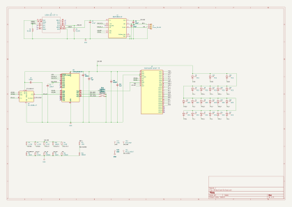
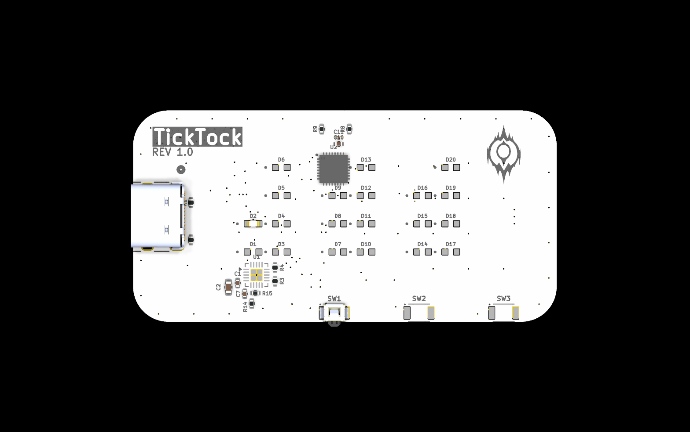
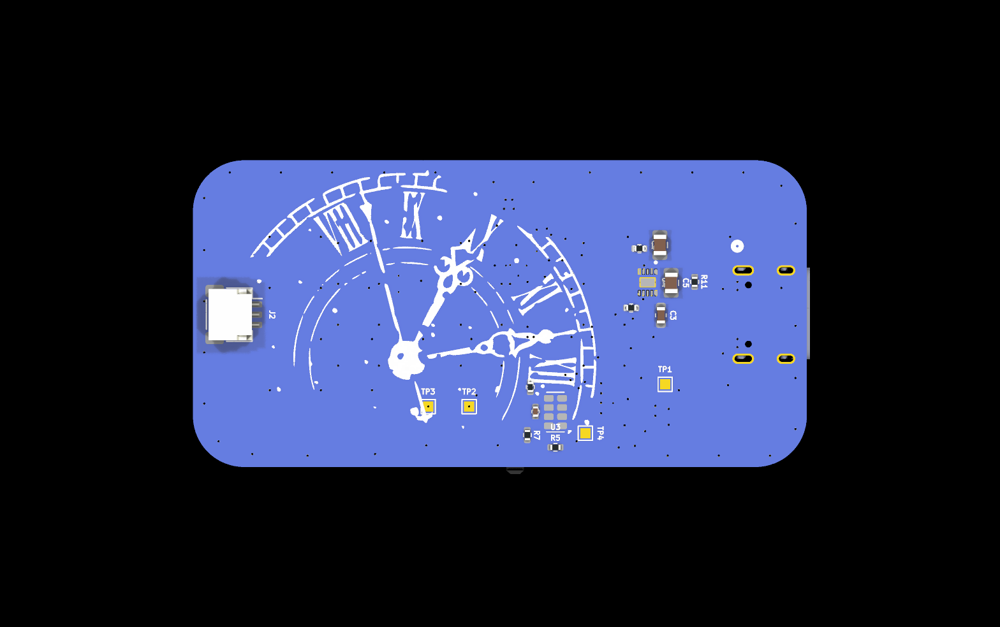

# TickTock — Pocket Binary Clock

A rechargeable pocket clock displaying **HH:MM:SS with 20 LEDs**, built around an ATtiny1616, a constant-current LED driver, and a real-time clock. Three edge-mounted buttons provide the planned MODE, PLUS, and MINUS controls, with USB-C for charging.

Designed in **KiCad 10**. This snapshot comes from **BinaryClock3**, with “TickTock REV 1.0” on the front silkscreen and a clock-face illustration on the back.

**Status: routed draft, not a manufacturing release.** The current checks report zero unconnected items and zero schematic-to-PCB parity issues, but electrical and design-rule violations remain. See [validation details](Hardware/VALIDATION.md).

## Schematic



The current schematic labels U4 as **BQ25186DLHR**. Its custom symbol and footprint identifiers still contain **BQ25185**; their suitability must be verified against the intended device before assembly. The earlier BQ24074 circuit is not included in this snapshot.

Open [Hardware/BinaryClock3.kicad_pro](Hardware/BinaryClock3.kicad_pro) in KiCad 10. Project-specific symbols, footprints, and available custom 3D models are included.

## Silkscreen


## PCB Layout


[Inner layer 1](images/Inner1.svg) · [Inner layer 2](images/Inner2.svg)

The saved board has **four copper layers** and a **1.6 mm thickness setting**. The plotted outline is approximately **60 × 30 mm**, larger than the original 50 × 30 mm target. Its saved appearance uses white front solder mask and blue back solder mask. The stackup currently specifies no copper finish; these settings need reconciliation with the intended manufacturing order.

The snapshot contains 334 track segments and 163 vias. These counts describe the saved design, not a fabrication approval.

## 3D Render




These are direct KiCad renders of the saved board. Some component bodies are absent because their 3D models are missing or unassigned; visible bare pads do not imply that those parts are omitted from the BOM.

## Bill of Materials

[Download BOM.csv](Production/BOM.csv), exported from the current schematic. It contains **52 component instances and 4 test points**. The external battery and thermistor are not included. Generic values and library names are not a complete purchasing specification; exact orderable parts, ratings, and pricing still need to be finalized.

| Reference | Value / part | Footprint | Quantity |
|---|---|---|---:|
| C1,C6,C7,C10 | 100nF | Capacitor_SMD:C_0402_1005Metric | 4 |
| C2 | 1µF | Capacitor_SMD:C_0603_1608Metric | 1 |
| C3 | 2.2µF | Capacitor_SMD:C_0603_1608Metric | 1 |
| C4,C5 | 10µF | Capacitor_SMD:C_0805_2012Metric | 2 |
| C11 | 1uF | Capacitor_SMD:C_0201_0603Metric | 1 |
| D1-D20 | RED | Custom Models:LED_APT1608LSECK_J3-PRV | 20 |
| J1 | USB4105-GF-A | Custom Models:USB4105_GCT | 1 |
| J2 | Conn_01x03 | Connector_JST:JST_SH_SM03B-SRSS-TB_1x03-1MP_P1.00mm_Horizontal | 1 |
| R1,R2 | 5.1kΩ | Resistor_SMD:R_0402_1005Metric | 2 |
| R3,R4 | 4.7kΩ | Resistor_SMD:R_0402_1005Metric | 2 |
| R5 | 47kΩ | Resistor_SMD:R_0402_1005Metric | 1 |
| R6,R7,R11 | 10kΩ | Resistor_SMD:R_0402_1005Metric | 3 |
| R8,R10,R12 | 100kΩ | Resistor_SMD:R_0402_1005Metric | 3 |
| R9 | 15kΩ | Resistor_SMD:R_0402_1005Metric | 1 |
| R14 | 1MΩ | Resistor_SMD:R_0402_1005Metric | 1 |
| R15 | 330kΩ | Resistor_SMD:R_0402_1005Metric | 1 |
| SW1-SW3 | SW_Push | Custom Models:SW_B3U-3000P | 3 |
| TP1 | UPDI | TestPoint:TestPoint_Pad_1.0x1.0mm | 1 |
| TP2 | SYS_PWR | TestPoint:TestPoint_Pad_1.0x1.0mm | 1 |
| TP3 | GND | TestPoint:TestPoint_Pad_1.0x1.0mm | 1 |
| TP4 | RTC_CLKOUT | TestPoint:TestPoint_Pad_1.0x1.0mm | 1 |
| U1 | ATtiny1616-M | Package_DFN_QFN:VQFN-20-1EP_3x3mm_P0.4mm_EP1.7x1.7mm | 1 |
| U2 | IS31FL3239-QFLS4-TR | Custom Models:QFN40P400X400X80-33N-D | 1 |
| U3 | RV-3028-C7 | Package_SON:MicroCrystal_C7_SON-8_1.5x3.2mm_P0.9mm | 1 |
| U4 | BQ25186DLHR | Custom Models:IC_BQ25185DLHR | 1 |

## Reading the Display

Each column represents one decimal digit. Add the weights of its illuminated LEDs to obtain that digit:

| Digit | Binary weights |
|---|---|
| Hour tens | 1, 2 |
| Hour units | 1, 2, 4, 8 |
| Minute tens | 1, 2, 4 |
| Minute units | 1, 2, 4, 8 |
| Second tens | 1, 2, 4 |
| Second units | 1, 2, 4, 8 |

## Repository Structure

```text
Hardware/
  BinaryClock3.kicad_pro
  BinaryClock3.kicad_sch
  BinaryClock3.kicad_pcb
  Custom_Libraries/
  3dmodels/
  reports/
  VALIDATION.md
Production/
  BOM.csv
images/
JOURNAL.md
README.md
```

The presentation follows [PCBCard](https://github.com/kwame-y/PCBCard). Backups, local editor state, and the source folder's history database are excluded.

## Remaining Work

- Resolve the ERC and DRC findings documented in the reports.
- Verify the charger symbol, physical pin mapping, and footprint against the intended part.
- Finalize the battery, connector polarity, and battery-temperature sensing arrangement.
- Confirm the final dimensions, stackup, finish, and assembly requirements.
- Implement and test firmware, including charger configuration and fault handling.
- Test an assembled prototype and enclosure fit before releasing production files.

## License

A project license has not yet been selected. Third-party symbols, footprints, and 3D models retain their original ownership and any applicable terms.
